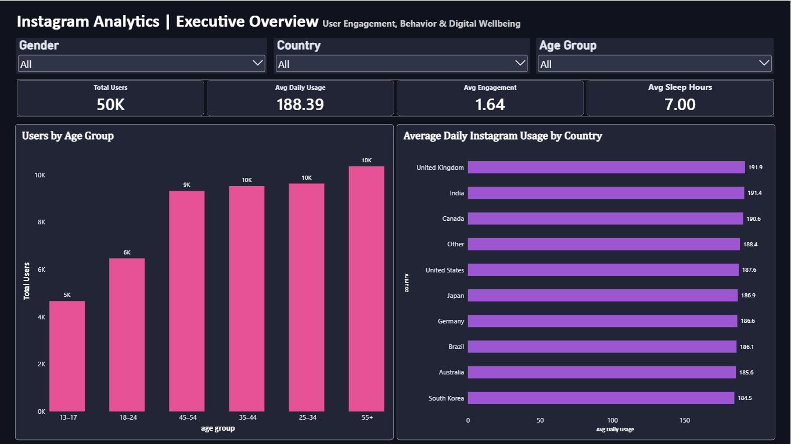
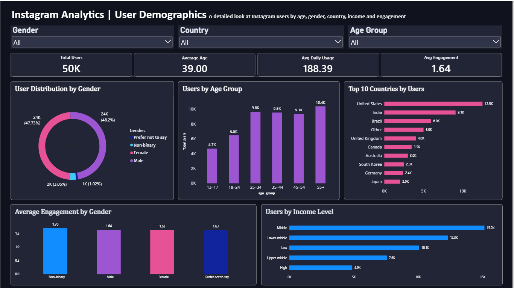
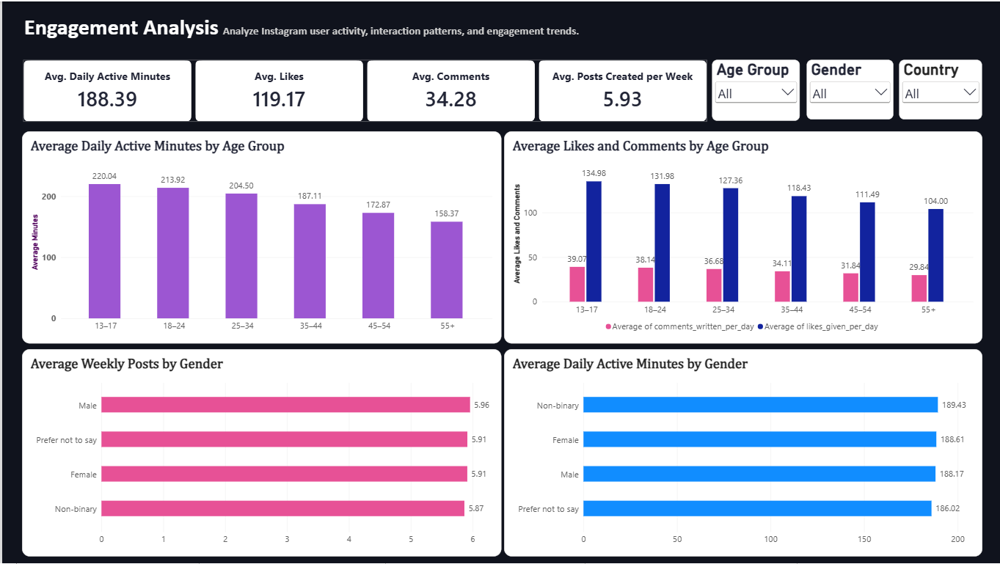
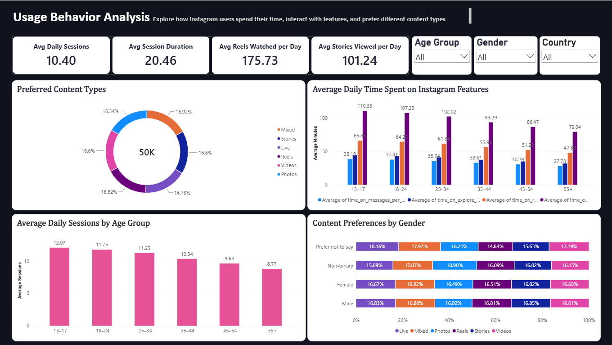
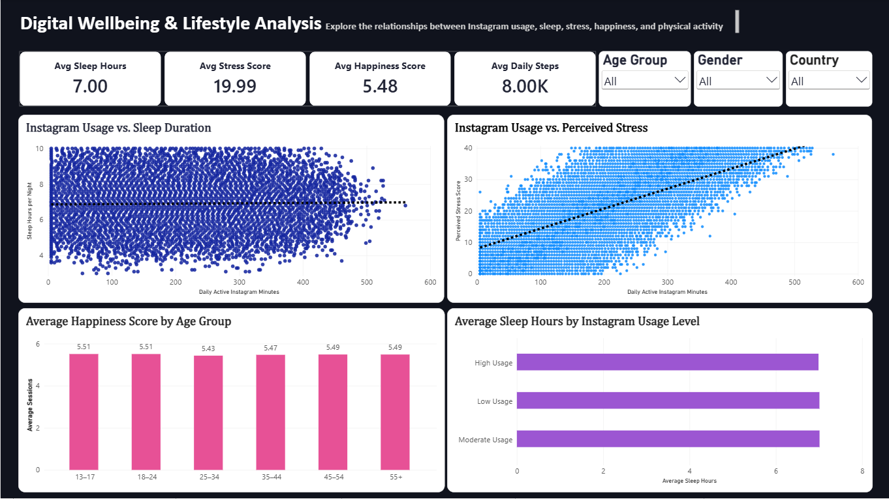
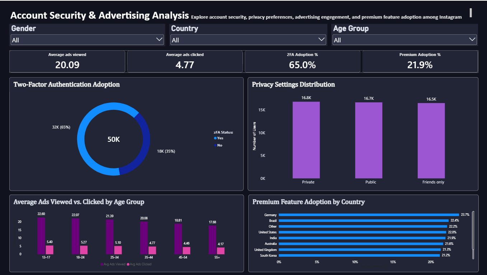

# Instagram User Lifestyle & Digital Behavior Analytics

**End-to-end data analytics portfolio project | Microsoft Excel + Power BI**

An exploratory analysis of **50,000 synthetic Instagram user records** covering demographics, engagement, usage patterns, lifestyle indicators, privacy, account security, and advertising. The project combines formula-driven Excel summaries with a six-page interactive Power BI report.

> **Data disclaimer:** This is simulated data, not an official Instagram dataset or evidence about real Instagram users. Patterns are descriptive; relationships between usage and wellbeing do **not** demonstrate causation.

## Project goals

- Explore the composition of the simulated user population by age, gender, and country.
- Compare daily usage, engagement, content preferences, and platform activity across segments.
- Examine descriptive associations between usage, sleep, stress, and happiness.
- Summarize privacy settings, two-factor authentication, premium-feature usage, and advertising engagement.
- Build an interactive, readable Power BI report with reusable metrics and slicers.

## Tools and skills

| Tool | How it was used |
|---|---|
| Microsoft Excel | Source inspection, descriptive statistics, formula-based KPI calculations, segment-level EDA, and summary charts |
| Power BI Desktop | Data import, interactive visuals, report pages, filtering, and presentation |
| DAX | Measures for KPIs and adoption percentages; calculated columns for categories and sort order |
| Power Query / data preparation | Data-loading and preparation workflow; consult the project documentation for what is confirmed versus planned |

## Data

- **Rows:** 50,000 synthetic user records.
- **Columns:** 59 in the working source described by the Excel analysis guide.
- **Example fields:** `user_id`, `age`, `age_group`, `gender`, `country`, `daily_active_minutes_instagram`, `sessions_per_day`, `likes_given_per_day`, `comments_written_per_day`, `reels_watched_per_day`, `sleep_hours_per_night`, `perceived_stress_score`, `self_reported_happiness`, `two_factor_auth_enabled`, `privacy_setting_level`, `ads_viewed_per_day`, `ads_clicked_per_day`, `uses_premium_features`.
- **Source type:** Synthetic / educational. Avoid interpreting the results as population estimates.

## Workflow: Excel → Power BI

1. **Inspect the source:** Review available columns, data types, categories, and metric definitions.
2. **Explore in Excel:** Calculate full-dataset KPIs and compare segments such as age, gender, country, content type, and privacy setting. The companion analysis workbook uses **formula-driven, pivot-equivalent aggregates**, not native Excel PivotTable objects.
3. **Use the original user-level data in Power BI:** Excel summary sheets are an analysis and validation companion, **not the data source for interactive Power BI visuals**. Importing the user-level records enables slicers to recalculate measures across different user subsets.
4. **Create Power BI calculations:** Define averages, distinct-user counts, adoption percentages, and category sort keys. For Yes/No text columns, compare with `"Yes"`, not DAX `TRUE()`.
5. **Build and refine six report pages:** Apply consistent layout, chart formatting, and slicers for age group, gender, and country.
6. **Validate:** Cross-check KPIs against Excel, inspect chart aggregation settings, and test slicer interactions before publication.

## Power BI report pages

| Page | Focus | Representative visuals |
|---|---|---|
| 1 — Overview Analysis | Audience and high-level activity | KPI cards, gender distribution, age groups, top countries |
| 2 — Demographics Analysis | User composition and segment comparisons | Age, gender, and other demographic comparisons |
| 3 — Engagement Analysis | Likes, comments, posts, and activity | Average engagement KPIs and age/gender comparisons |
| 4 — Usage Behavior Analysis | Sessions, content types, and time spent | Content-preference donut, feature-time and session comparisons |
| 5 — Digital Wellbeing & Lifestyle Analysis | Sleep, stress, happiness, activity | Usage-vs-sleep and usage-vs-stress scatterplots, happiness by age, sleep by usage level |
| 6 — Account Security & Advertising Analysis | 2FA, privacy, ads, premium usage | 2FA donut, privacy categories, ad views/clicks by age, premium adoption by country |

All pages were designed around interactive **Age Group**, **Gender**, and **Country** slicers. Screenshots show the report's state at the time of capture; check the `.pbix` for the latest saved version.

## Selected metrics

The Excel analysis workbook reports the following full-data results (rounded):

| Metric | Excel analysis |
|---|---:|
| Users | 50,000 |
| Average age | 39.00 |
| Average daily Instagram minutes | 188.39 |
| Average daily sessions | 10.40 |
| Average reels watched per day | 175.73 |
| Average sleep hours per night | 7.00 |
| Average perceived stress score | 19.99 |
| Average self-reported happiness | 5.48 |
| Average engagement score | 1.64 |

The final Page 6 screenshot shows **20.09 average ads viewed/day**, **4.77 average ads clicked/day**, and **21.9% premium adoption**. These are screenshot-observed Power BI values, not independently recalculated from the raw dataset here.

### Important validation item: 2FA

The Excel analysis workbook reports **35.004%** for its *two-factor authentication rate*, whereas the Page 6 Power BI screenshot shows **65.0%** for *2FA Adoption %*. This discrepancy must be reconciled against the raw `two_factor_auth_enabled` values and the exact Yes/No counting logic **before** presenting a single adoption rate as verified. Do not silently treat the two figures as equivalent.

## Example DAX measures

These examples assume that `user_id` identifies users and that the relevant security columns contain the text `Yes` and `No`:

```dax
2FA Adoption % =
DIVIDE(
    CALCULATE(
        DISTINCTCOUNT(InstagramUsers[user_id]),
        InstagramUsers[two_factor_auth_enabled] = "Yes"
    ),
    DISTINCTCOUNT(InstagramUsers[user_id]),
    0
)
```

```dax
Premium Adoption % =
DIVIDE(
    CALCULATE(
        DISTINCTCOUNT(InstagramUsers[user_id]),
        InstagramUsers[uses_premium_features] = "Yes"
    ),
    DISTINCTCOUNT(InstagramUsers[user_id]),
    0
)
```

Format both measures as **Percentage** in Power BI. Verify the column values and data types before reusing the formulas with another dataset.

## Screenshots

Add the six final dashboard screenshots to `Dashboard_Screenshots/`, then uncomment the following examples and update filenames if necessary:

<!--






-->

## Repository layout

```text
Instagram-User-Analytics-Excel-PowerBI/
├── Dataset/                    # Final publishable synthetic source data
├── Excel_Analysis/             # Excel EDA and supporting workbook(s)
├── PowerBI/                    # Power BI .pbix report
├── Dashboard_Screenshots/      # Six page screenshots
├── Documentation/              # Full project documentation (.docx)
└── README.md
```

## How to explore

1. Open the Excel analysis workbook to inspect descriptive KPIs and grouped comparisons.
2. Open the `.pbix` file in **Power BI Desktop** (if included in the repository).
3. Navigate through the six pages.
4. Change the **Gender**, **Country**, and **Age Group** slicers to see filtered results.
5. Clear filters between comparisons. Use the raw data and measure definitions to verify any findings you cite.

## Challenges and lessons learned

- **Sorting:** Custom sort columns helped place age groups and usage levels in meaningful order; avoid circular dependencies between the display category and its sort key.
- **DAX types:** A Boolean `TRUE()` comparison caused an error when a Yes/No field was stored as text. Matching the actual source type resolved it.
- **Scatterplot overplotting:** Tens of thousands of user-level points made the wellbeing charts dense. Small/transparent markers or grouped usage intervals are possible readability improvements; do not claim grouped versions are implemented unless the saved report contains them.
- **Cross-tool checks:** Excel and Power BI metrics should agree when the same definition, filters, and population are used.

## Limitations

- Synthetic data may contain artificial distributions and internally inconsistent relationships.
- Observational plots are descriptive and cannot establish causal effects.
- Definitions of engagement, stress, and some behavioral metrics should be verified against the source documentation.
- Segment differences may be small or influenced by sample sizes.
- The Excel 2FA versus Power BI 2FA discrepancy remains an explicit validation task.

## Documentation

For the fuller project narrative, Excel EDA workflow, calculation explanations, page-by-page dashboard guide, and handoff checklist, see:

`Documentation/Instagram_Analytics_Project_Full_Documentation.docx`

## Portfolio context

This project demonstrates practical skills in **Excel analysis, descriptive EDA, Power BI, DAX, dashboard design, troubleshooting, and communicating limitations**.
